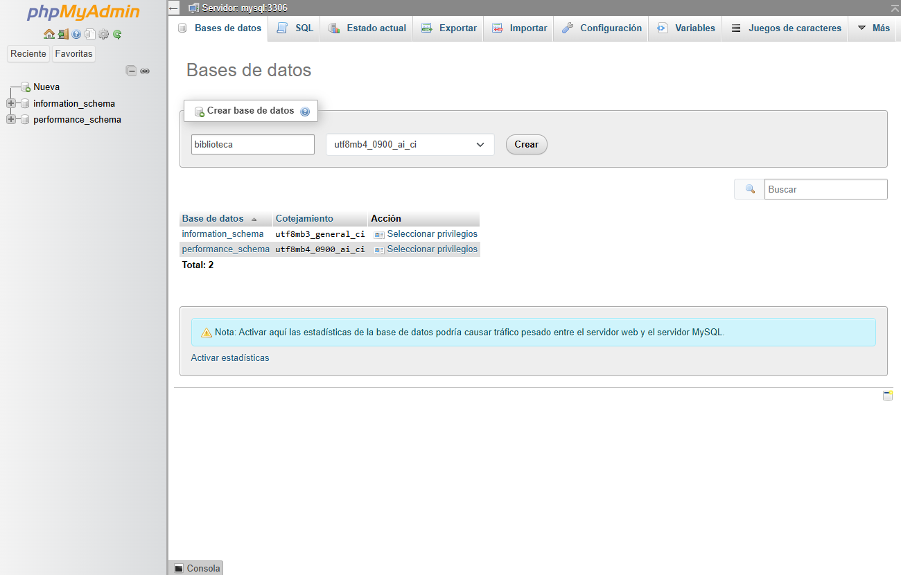
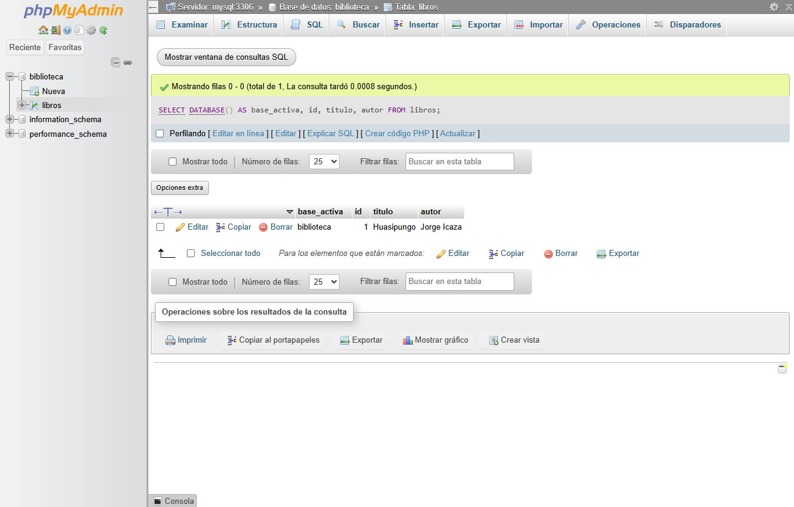

# TAS4 · Red de contenedores MySQL y phpMyAdmin

La prueba consistió en guardar un libro desde phpMyAdmin y recuperar el mismo registro desde la consola de MySQL. Así se puede comprobar el recorrido completo, desde el navegador hasta la base de datos.

## Cómo se conectan los contenedores

Los dos servicios comparten la red de tipo *bridge* `tas4-red-mysql_aula`. Desde el navegador, la entrada es `http://127.0.0.1:8084`. Docker dirige esa conexión al puerto 80 de phpMyAdmin. Desde phpMyAdmin, en cambio, la dirección del servidor es `mysql:3306`. Docker resuelve `mysql` porque es el nombre del servicio en la red compartida. El puerto de MySQL queda accesible dentro de esa red. [Redes en Docker Compose](https://docs.docker.com/compose/how-tos/networking/)

## Puesta en marcha

Con Docker en ejecución, desde la carpeta del proyecto se copia el archivo de variables. En PowerShell se puede hacer así:

```powershell
Copy-Item .env.example .env
```

En `.env` hay que escribir dos contraseñas distintas. `MYSQL_ROOT_PASSWORD` corresponde al administrador y `MYSQL_PASSWORD` al usuario `estudiante`, que se utiliza en phpMyAdmin. El archivo `inicio/permisos.sql` da a `estudiante` permiso para crear y administrar `biblioteca`. La base se crea después, desde el navegador.

```powershell
docker compose up -d --wait
docker compose ps
docker network inspect tas4-red-mysql_aula --format '{{range .Containers}}{{println .Name}}{{end}}'
```

La inspección de la red mostró los contenedores `tas4-red-mysql-mysql-1` y `tas4-red-mysql-phpmyadmin-1`.

## Creación de la base y prueba de lectura

1. Abrir phpMyAdmin en `http://127.0.0.1:8084` e iniciar sesión con `estudiante` y su contraseña.
2. En **Bases de datos**, escribir `biblioteca` en el campo de creación y pulsar **Crear**.



3. Seleccionar `biblioteca`, abrir la pestaña **SQL** y ejecutar las dos instrucciones siguientes.

```sql
CREATE TABLE libros (
  id INT PRIMARY KEY,
  titulo VARCHAR(100) NOT NULL,
  autor VARCHAR(100) NOT NULL
);

INSERT INTO libros (id, titulo, autor)
VALUES (1, 'Huasipungo', 'Jorge Icaza');
```

4. En la misma pestaña, consultar el nombre de la base activa junto con el título y el autor.

```sql
SELECT DATABASE() AS base_activa, id, titulo, autor FROM libros;
```



Para contrastar el resultado, se ejecutó la misma consulta dentro del contenedor de MySQL. El cliente pide la contraseña de `estudiante` al pulsar Enter.

```powershell
docker compose exec mysql mysql -u estudiante -p biblioteca -e "SELECT DATABASE() AS base_activa, id, titulo, autor FROM libros;"
```

| base_activa | id | titulo | autor |
| --- | ---: | --- | --- |
| biblioteca | 1 | Huasipungo | Jorge Icaza |

El mismo libro apareció en ambas consultas. La fila recuperada desde MySQL confirma que el registro creado en el navegador quedó guardado en `biblioteca`.
